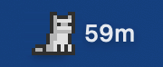
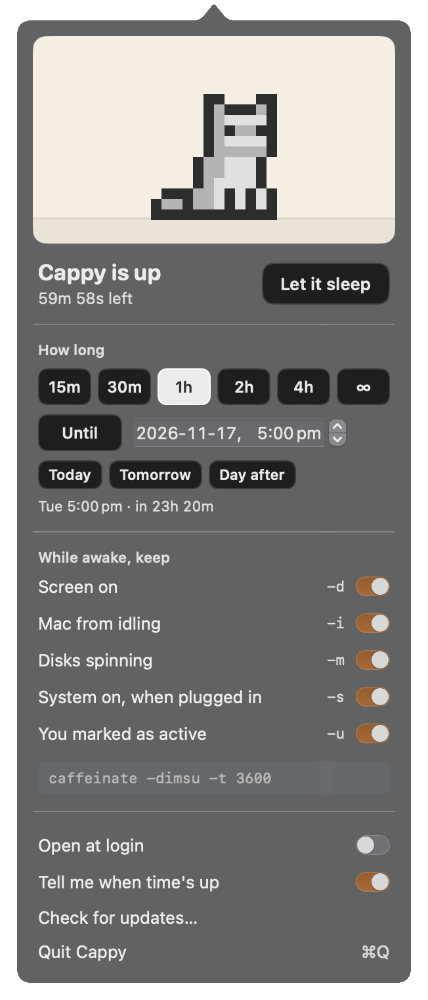
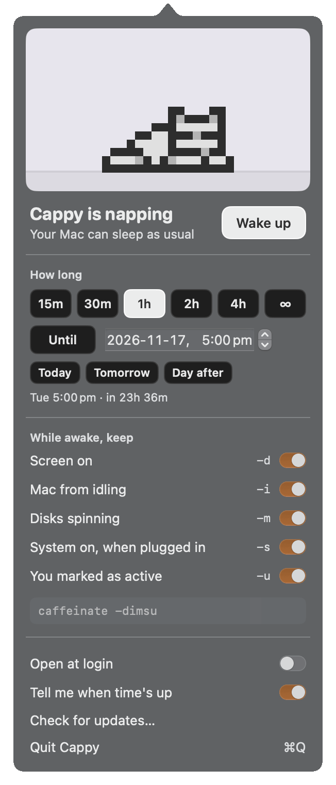
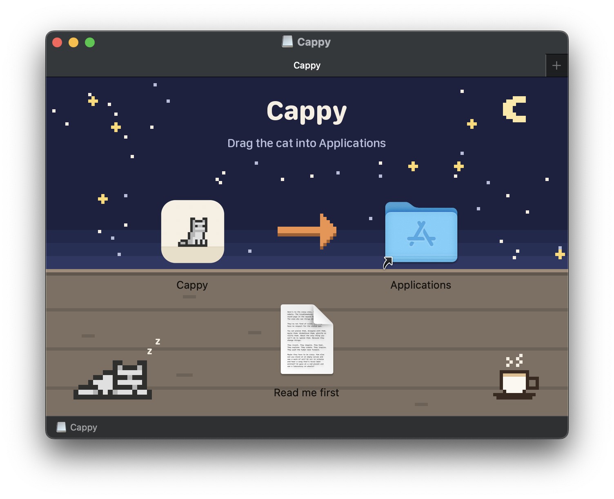

# Cappy

A tiny pixel cat in your menu bar that keeps your Mac awake.

  
  &nbsp;&nbsp;
  

Cappy is a friendly front end for `caffeinate`, the keep-awake tool built into macOS. Pick how long and what to keep awake, and Cappy sits up in the menu bar with a countdown until time's up, then curls up for a nap.

  
  &nbsp;&nbsp;
  

## What it does

- **Wake it up from the menu bar.** Click the cat, then Wake up or Let it sleep. While awake, the time left sits next to it.
- **Any length you like.** 15 minutes, 30 minutes, 1, 2 or 4 hours, forever, or until a time and date (with Today, Tomorrow and Day after shortcuts).
- **Choose what stays awake.** Each of `caffeinate`'s switches is a toggle in plain English: the screen, idle sleep, disks, the whole system on power, and "you're active". The exact command is shown underneath.
- **A little cat that lives there.** Cappy sits, grooms and naps in pixel art. It honours Reduce Motion and stops animating while your screens are off.
- **Tells you when time's up**, if you want it to.
- **Opens at login**, if you want it to.
- **Remembers your choices** between launches.
- **Can't leave your Mac stuck awake.** If Cappy quits or crashes, `caffeinate` stops with it.
- **Updates itself.** New versions show up in the menu and install in a click.

## Installing

Download the latest `Cappy-x.y.z.dmg` from [Releases](https://github.com/Sehgal-Arjun/cappy/releases/latest) and drag the cat into Applications. Needs an Apple Silicon Mac on macOS 13 or later.

  

Cappy isn't notarized by Apple, so macOS blocks it the first time:

1. Open Cappy from Applications. macOS says it can't be opened. Click Done.
2. Open System Settings › Privacy & Security, scroll down, and click **Open Anyway** next to Cappy.
3. Confirm. From then on it opens normally.

The DMG includes a "Read me first" note with the same steps.

## What the switches mean

| In Cappy | Flag | Keeps… |
| --- | --- | --- |
| Screen on | `-d` | the display from sleeping |
| Mac from idling | `-i` | the Mac from idle sleep |
| Disks spinning | `-m` | disks from idle sleep |
| System on, when plugged in | `-s` | the whole system awake, on AC power only |
| You marked as active | `-u` | you counted as active, so the screen doesn't dim |

At least one has to be on.

## Built with

- **Swift and SwiftUI**, as a Swift package (no Xcode project). AppKit runs the menu bar item and its popover.
- **`caffeinate`**, run as a child process. Cappy doesn't touch power settings itself.
- **[Sparkle](https://sparkle-project.org)** for signed auto-updates, served from GitHub Releases.
- **[dmgbuild](https://github.com/dmgbuild/dmgbuild)** and **Pillow** for the installer window and the app icon.

Want to build it yourself? See [docs/DEVELOPING.md](docs/DEVELOPING.md).

## Credits

Code is MIT licensed. The cat sprites are by [Elthen](https://elthen.itch.io/2d-pixel-art-cat-sprites) and are used under their own licence, not MIT.
