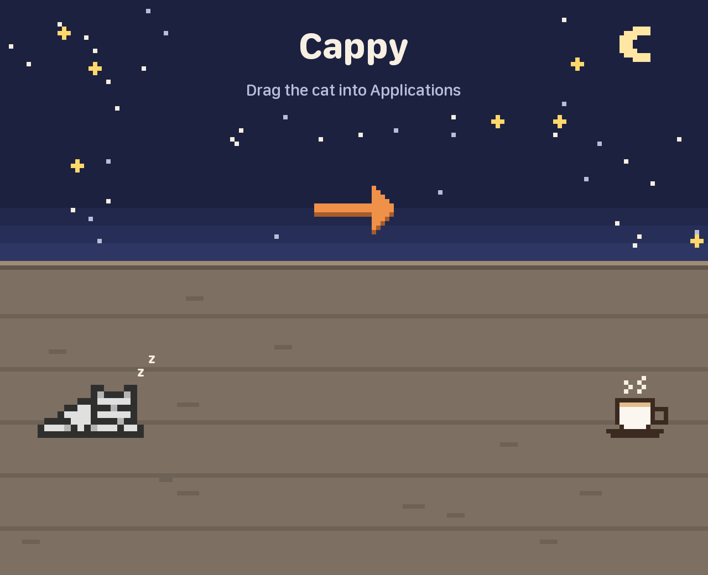

# Cappy

A tiny pixel cat in your menu bar that keeps your Mac awake.

Cappy is a friendly front end for macOS's built-in `caffeinate`. Pick how long, pick what to keep awake, and Cappy sits up in the menu bar until time's up, then curls up for a nap.

## Building

Needs macOS 13+ and Swift 5.10+ (the Xcode command line tools are enough).

```bash
./scripts/build-app.sh   # builds dist/Cappy.app
./scripts/make-dmg.sh    # builds the app and wraps it in dist/Cappy-<version>.dmg
```

The DMG opens to a pixel-art window (night sky, Cappy and Applications on a shelf, a "Read me first" note with the steps below). The first run sets up a local `.venv` with [dmgbuild](https://github.com/dmgbuild/dmgbuild), which lays out the window without scripting Finder.



The window art comes from `scripts/make-dmg-background.py` (needs Pillow; `.venv/bin/pip install pillow`). Icon positions in `scripts/dmg/settings.py` must match it.

The app icon is generated from the cat sprite with `python3 scripts/make-icon.py` (needs Pillow). The resulting `Resources/AppIcon.icns` is committed, so you only need this to change the icon.

## Releasing and auto-updates

Cappy updates itself with [Sparkle](https://sparkle-project.org). Installed copies check `https://github.com/Sehgal-Arjun/cappy/releases/latest/download/appcast.xml` once a day; when there's a newer build they offer it in the menu, then download, verify and install it.

To ship a new version:

1. Bump `CFBundleShortVersionString` **and** `CFBundleVersion` in `Resources/Info.plist` (Sparkle compares `CFBundleVersion`), and merge to `main`.
2. From a clean `main`, run `./scripts/release.sh [notes.md]`. It builds the DMG, signs it with the Sparkle key, writes `appcast.xml` and creates the GitHub release with both attached.

Updates are signed with an EdDSA key kept in the login Keychain under the account `cappy` (created with Sparkle's `generate_keys --account cappy`; `./scripts/sparkle-tools.sh` fetches the tools). The public half is `SUPublicEDKey` in `Info.plist`. **Back up that key** (`generate_keys --account cappy -x cappy-key.txt`, then store it somewhere safe): without it, no future update can be installed by existing copies.

## Opening it the first time

Cappy isn't notarized by Apple, so macOS blocks the first launch:

1. Drag Cappy into Applications and open it. macOS says it can't be opened. Click Done.
2. Open System Settings › Privacy & Security, scroll down, and click **Open Anyway** next to Cappy.
3. Confirm. From then on it opens normally.

## Credits

Code is MIT licensed. The cat sprites are by [Elthen](https://elthen.itch.io/2d-pixel-art-cat-sprites) and are used under their own licence, not MIT.
